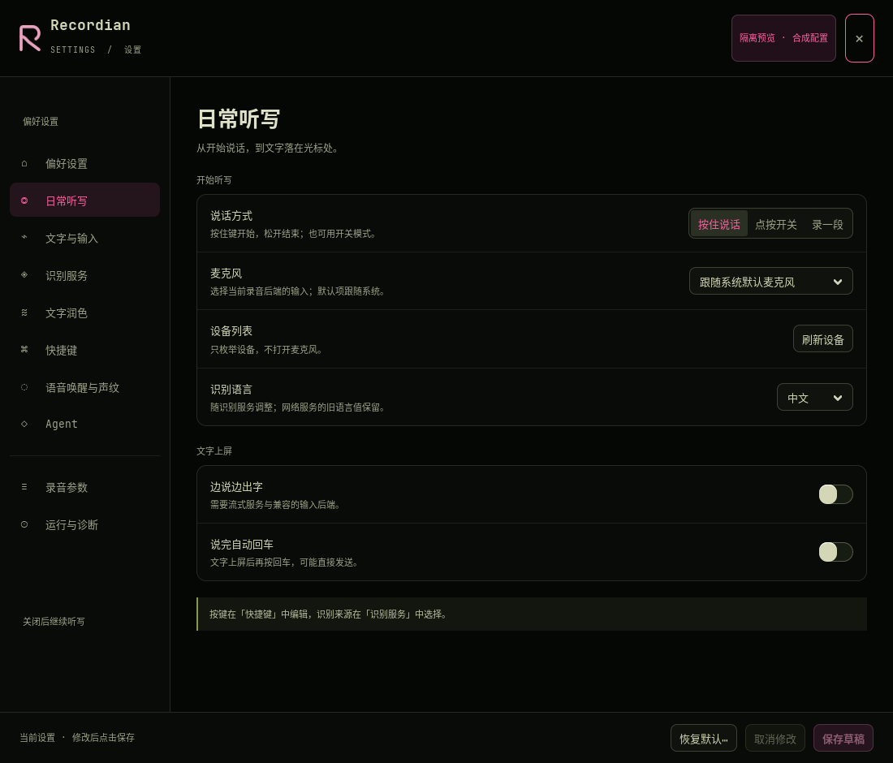

# 设置设备刷新验证

## 范围与基线

本轮从 `f74a8942d3fe668ecf225bef5c0bdbfdde109f6e` 分出 `codex/settings-device-refresh`。
旧交付 `7bbc303` 的菜单精简、声纹整合、多行常用词、API 统一、Agent 页面和高级分页已存在，不重复实现。
偏好页已有开机自启，未找到其他缺失开关的明确需求；未添加猜测出的开关。
中文纠错实验分支仍未达既定质量/延迟门槛，本轮不修改或部署它们。

本轮修复两个经 GTK 测试复现的问题：

- 连续刷新/切换后端每次都创建新线程，旧 generation 检查只能防止结果覆盖，不能限制资源。
- 取消或恢复默认未失效设备枚举，可能回填旧后端列表；已保存的断连设备不在列表时控件空白。

现在同一窗口最多一个在途设备枚举，额外刷新合并为一次最新请求；后端变化立即清理旧列表并保留当前设备占位。
关闭后丢弃迟到结果和待处理请求；取消、恢复默认同步草稿与下拉框；查询期间用户改变的设备不会被覆盖。
刷新按钮在查询期间显示忙碌状态，意外查询异常或线程启动失败后可重试。现有目录枚举会吞掉常见超时，返回默认/已配置占位列表，此时按钮恢复「刷新设备」，不显示失败提示。同后端普通草稿同步不额外枚举。

## 自动化与 UI 证据

- 原设置相关基线：63 passed。
- 首轮新增六项回归：5 failed / 1 passed，失败准确暴露上述缺陷；实现后全部通过。
- 最终新增八项 GTK 回归，覆盖突发刷新、取消（请求未结束/已结束）、恢复默认、关闭、选择保留、查询失败重试、同后端取消。
- 全仓离线测试：**1799 passed, 41 skipped, 1 deselected**（95.83 秒）。显式 `-m 'not integration'` 排除读取真实 Jev 配置并请求模型的测试。
- `ruff check --no-cache src/ tests/`、新增脚本 lint、`git diff --check` 和 `tests/verify_docs.py` 通过。
- 714 条警告主要来自 Python 3.14 / PyGObject 的 asyncio 弃用提示，另有现有测试依赖警告；测试没有失败。
- 真 GTK 3.24.52 控件在 Xvfb 上创建、切换、回滚、关闭；不是 HTML 模型。截图使用合成配置，未读取用户配置或启动托盘/听写后台。



## 可重复资源测量

脚本：[`scripts/benchmark_settings_refresh.py`](../scripts/benchmark_settings_refresh.py)。Python 3.14，同一机器，基线和候选分别运行。
原始数据来自初始候选 `c27c56175ffbe6cce31960d0b4d8b4462b4afd0a`，含源码 SHA256、逐轮记录、设备选项数量及剩余线程数；不保存真实设备名称。后续独立审查仅追加线程启动失败的状态回滚，该新异常路径由回归测试验证；原始性能数据不冒充追加修复后的重新测量。

### 受控慢枚举压力测试（5 轮，各 32 次连续刷新）

真实 GTK 事件循环、线程和 Python 子进程；每个枚举子进程只等待 150ms，不接触麦克风。脚本直接调用 `refresh_microphones()` 32 次，不是模拟鼠标连点：候选的刷新按钮在第一次请求后禁用，普通点击不会产生同样请求。录音后端切换仍可追加最新需求。
以下是各轮中位数；RSS 每 20ms 采样，包含父进程和这些合成子进程，属于观测峰值，不是严格内存上界。

| 指标 | 基线 | 候选 |
| --- | ---: | ---: |
| 实际枚举次数 | 32.00 | 2.00 |
| 并发枚举线程峰值 | 32.00 | 1.00 |
| 子进程峰值 | 32.00 | 1.00 |
| 相对初始 RSS 峰值增量 | 330.96 MiB | 10.35 MiB |
| GTK 派发 32 次请求 | 4.59 ms | 0.32 ms |
| 完成最终列表 | 231.43 ms | 334.99 ms |
| 20ms 心跳最大间隔 | 21.11 ms | 21.05 ms |

收益是有界资源与更小的请求派发成本。串行执行首个和最新请求，使这一压力场景的最终完成时间增加；不能宣称所有延迟都下降。
两臂每轮默认设备均保留，结束后额外线程数均为 0。测试对象是单个设置窗口，多次关闭重开仍可能短暂留有前一窗口的有限时长枚举。

### 实际系统枚举（7 轮，单次刷新）

只读执行 `pactl --format=json list sources`，通过现存用户 Pulse socket 连接系统服务。核对退出码为 0，5 个 source，过滤 monitor 后界面显示 4 个选项（含默认）。
未打开任何输入流。最初环境缺少 XDG_RUNTIME_DIR 导致连接拒绝的试跑不计入最终数据；该失败不能算成功设备测量。

| 指标 | 基线 | 候选 |
| --- | ---: | ---: |
| 枚举函数耗时 | 4.56 ms | 5.29 ms |
| 单次请求派发 | 0.20 ms | 0.31 ms |
| 列表完成 | 6.13 ms | 9.84 ms |

单次枚举没有证明提速；此次候选列表完成中位数更高，含按钮状态更新、GTK 调度与测量成本。样本量小且顺序执行，不能据此推断普遍差异。
真实枚举的 RSS 字段**只统计父进程**，不包括 pactl；短请求期间可能没有足够心跳样本，0 间隔不表示零延迟。

原始记录：[压力基线](validation/settings-device-refresh/baseline-stress.json)、[压力候选](validation/settings-device-refresh/candidate-stress.json)、[实际枚举基线](validation/settings-device-refresh/baseline-real.json)、[实际枚举候选](validation/settings-device-refresh/candidate-real.json)。

## 独立复核与慢后端取舍

本轮另由两位未参与实现的新审查者分别检查异步状态和测量。代码审查以真实 GTK/线程补测了快速后端切换后取消、失败后处理最新请求、主线程更新控件以及关闭后的迟到结果。
发现一项 P3：`Thread.start()` 被系统拒绝时，原先已设置的忙碌标志和禁用按钮不能恢复。现已捕获启动的 `RuntimeError`，回滚状态，保留设备选择并允许重试；新增测试先复现失败再通过。
追加修复后本地设置相关 **72 passed**；完整离线回归 **1800 passed, 41 skipped, 1 deselected**（74.49 秒）；完整 Ruff lint、文档检查通过。独立审查者另执行新增回归与三个真实线程补测，**4 passed**，确认 P3 关闭，未发现新问题。
线程取消是结果失效，不强行终止已运行的枚举；关闭窗口不等待线程结束，也不再启动待处理枚举。

性能审查独立复跑 5 轮原合成压力实验：完成中位数 230.09→334.16ms，调用数 32→2，并发线程/子进程峰值 32→1，额外线程最终为零，与原报告一致。
另用真实 GTK 事件循环和枚举器的真实超时降级逻辑、合成 `_query` 验证慢后端（每种情景单轮，未调用真实设备）：

| 合成情景 | 基线 | 初始候选 |
| --- | ---: | ---: |
| 单次查询等待 3 秒后超时 | 3.002s | 3.002s |
| 直接调用 32 次、每次 3 秒超时 | 3.007s | 6.004s |
| t=100ms 从旧慢后端切换到 10ms 快后端：新列表出现时间 | t=111ms | t=3013ms |

[逐次慢查询记录](validation/settings-device-refresh/review-slow-results.json)。切换情景中，旧查询使用 `time.sleep(3)` 后抛 `subprocess.TimeoutExpired`，新查询等待 10ms 后返回合成 arecord 设备列表；并非真实设备故障现场。
**慢旧后端会造成明显的设备列表等待退化（该切换实验额外约 2.90 秒），这项取舍仍未消除。** 两臂 20ms GTK 心跳最大约 21–22ms，说明不是界面卡死；用户仍能切页、修改、取消或关闭，但新设备列表须等旧枚举收尾。两个连续慢请求可接近 6 秒。
正常请求的约 104ms 压力增量不能单独证明主观体验明显下降，也不能代表慢后端情景。若后续要求消除此退化，需要设计可取消的底层枚举，不能仅靠 generation 失效。

原脚本 `completion_ms` 等待所有 worker 结束，不总等于最新列表的出现时间：上述基线切换虽 t=111ms 已显示新列表，旧 worker 到约 3 秒才结束。不得将该指标泛化为任意情景下的用户可见延迟。
只有 5/7 轮且按臂顺序运行，没有置信区间；合成 Python 子进程内存不代表真实 pactl，20ms RSS 采样可能漏峰。真实设备数据在独立复核中只作静态核对，未再次读取用户设备。

初始提交远端 [CI](https://github.com/zz8011/Recordian/actions/runs/38635643969) 与 [Rust native runtime](https://github.com/zz8011/Recordian/actions/runs/38635644074) 共六项检查全绿：Python 3.10/3.11/3.12 各 1714 passed、127 skipped；required-native Python 3.10/3.12 各 1744 passed、97 skipped。
CI 的 mypy 为 `continue-on-error`：有 11 条错误，与主分支固定 SHA `f74a894` 的 CI 逐条一致，不能把绿色任务解释为类型检查无误。GTK 设置回归在远端缺少相应环境而跳过，本地 Xvfb 结果不能表述为真实 Wayland 验收。GitHub 当时没有人工审查，本报告的独立审查者为代理；追加修复提交的最终 CI 以 [PR #5](https://github.com/zz8011/Recordian/pull/5) 的提交状态为准。

## 复现

需要已安装 GTK3/PyGObject、Xvfb、psutil 和开发测试依赖。在工作树根运行（以本机 Python 路径为例）：

```bash
mkdir -p .scratch
git show f74a894:src/recordian/native_settings.py > .scratch/baseline-native_settings.py
PYTHONPATH=src xvfb-run -a -s '-screen 0 1600x1200x24' /home/zz8011/Projects/recordian/.venv/bin/python scripts/benchmark_settings_refresh.py --mode stress --rounds 5 --output .scratch/candidate-stress
# 增加 --source .scratch/baseline-native_settings.py，输出到不同目录，即可测基线。
# real 模式需已有可访问的用户音频服务；不启动或修改该服务。
XDG_RUNTIME_DIR=/run/user/1000 PULSE_SERVER=unix:/run/user/1000/pulse/native PYTHONPATH=src xvfb-run -a -s '-screen 0 1600x1200x24' /home/zz8011/Projects/recordian/.venv/bin/python scripts/benchmark_settings_refresh.py --mode real --rounds 7 --output .scratch/candidate-real
PYTHONPATH=src xvfb-run -a /home/zz8011/Projects/recordian/.venv/bin/python -m pytest -q -m 'not integration'
```

`/run/user/1000` 是本次环境；其他用户需改为自己的已有运行时目录。脚本不启动音频服务。

## 未测及交付边界

没有测量自然麦克风→ASR→润色 API→目标应用的端到端延迟，未调用付费或真实模型服务，未读取录音、转录、密钥。
本次 GTK 验证是隔离 X11/Xvfb；用户正在运行的 Wayland 托盘会话和实体麦克风热拔插未验收。
未构建/安装运行时、未重启应用、未合并主分支。41 项跳过仍保留其原有环境/可选能力限制；本轮不代表这些能力已通过。
README/CHANGELOG 已同步当前界面与修复范围。
